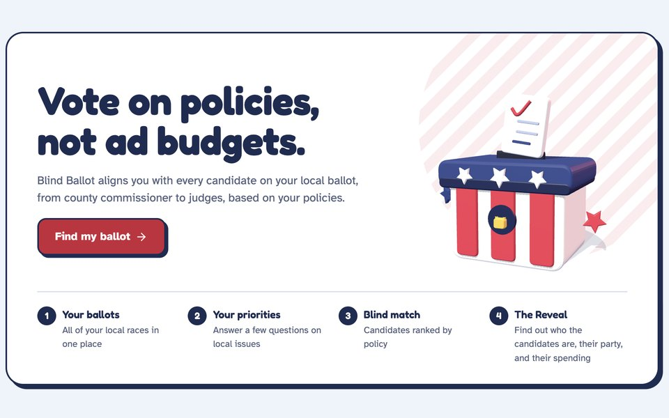

# Blind Ballot

**Vote on policies, not ad budgets. · HackOHI/O 2026**

  

**[Try it live →](https://blindballot-app.vercel.app)**

Blind Ballot is a nonpartisan voter guide that helps Ohio voters compare candidates based on policy positions before seeing their names, parties, endorsements, or campaign spending.

The website is designed to reduce the influence of name recognition and political advertising. Instead of asking voters to begin with a candidate, Blind Ballot begins with the issues that matter to them.

## What the website does

Voters enter an Ohio address or ZIP code to find the races and ballot issues connected to their area. They then answer short, plain-language questions about priorities such as schools, taxes, housing, roads, public safety, parks, and local services.

For each question, voters can also say how important the issue is to them. Blind Ballot compares those answers with candidate positions and presents the closest matches under anonymous labels such as **Candidate A** and **Candidate B**.

After reviewing the policy matches, voters can reveal each candidate’s:

- Name
- Party
- Endorsements
- Campaign spending
- Explanation of their positions

This order allows voters to form an opinion from policy agreement before seeing information that may introduce bias.

## The voter experience

1. Find your local ballot.
2. Answer questions about the issues you care about.
3. Choose how important each issue is to you.
4. Compare candidates without names or party labels.
5. Reveal candidate identities and campaign information.
6. Save or print **My Blind Ballot** as a personal voting reference.

Ballot issues such as levies are handled separately because there is no candidate identity to hide. The website shows whether the voter’s answers lean toward yes, no, or remain mixed.

## What makes Blind Ballot different

- Matches are based on stated policy positions, not fundraising or popularity.
- Candidate identities remain hidden until after the comparison.
- There are no ads, paid placements, or sponsored rankings.
- Voters decide which issues carry the most weight.
- Candidates receive the same space to explain their answers.
- The website does not label candidates as good or bad.

Names, parties, endorsements, and spending cannot change a match result. They are shown only after the policy comparison is complete.

## Candidate participation

Candidates can use the candidate portal to answer the same questions shown to voters. Each answer includes a short explanation in the candidate’s own words.

Real candidates who have not submitted positions are shown as **No candidate has answered yet**. Blind Ballot does not invent positions for real people.

## Election information

Blind Ballot uses public information from sources including:

- U.S. Census Bureau district and geographic data
- Ohio county boards of elections
- Federal Election Commission campaign-finance data

Some candidate positions and matches are fictional and clearly labeled for demonstration. Real election information and demo content are kept separate.

## Privacy and neutrality

Voter answers are used to produce the comparison and are not stored. An optional question about usual party preference is never used to calculate matches.

Blind Ballot is nonpartisan. It does not recommend a party, predict election results, or tell anyone how to vote. Its purpose is to make policy differences easier to understand and help voters make their own informed choices.

## Current scope

Blind Ballot currently focuses on Ohio elections. Coverage depends on the public information available from state and county election offices. A street address provides more accurate local results than a ZIP code when a ZIP crosses county boundaries.

Blind Ballot is a prototype created for HackOHI/O 2026 and is not an official election service.
